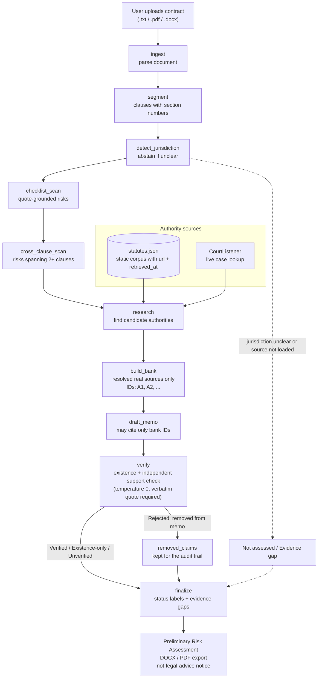

# Legal Copilot

Privacy-first legal document analysis starter built with FastAPI, LangGraph, Gemini, ephemeral Qdrant, and Next.js.

For the six judging criteria, a truthful three-minute pitch, proposed pilot metrics, and deployment boundaries, see [the submission brief](docs/SUBMISSION_BRIEF.md). The current code has not had a live evaluation after the latest memo-generation change.

## Run locally

1. Copy `backend/.env.example` to `backend/.env` and set provider keys as needed.
2. Start the API from `backend`: `python -m venv .venv`, activate it, `pip install -e .`, then `uvicorn app.main:app --reload`.
3. Start the UI from `frontend`: `npm install`, `npm run dev`.

The API defaults to ephemeral in-memory session/document state and Qdrant `:memory:`. No user document is written to disk. The frontend keeps the selected file in browser memory and uploads only for the active analysis session. Use HTTPS and redact session IDs from reverse-proxy access logs before exposing this service. Gemini 2.5 can apply implicit context caching to repeated large prefixes; cache hits and savings depend on provider behavior and are not guaranteed. Explicit remote cache objects are not created because they would complicate purge guarantees.

## Boundaries

This is a working application scaffold, not a substitute for advice from a licensed lawyer. It deliberately returns jurisdiction and source coverage gaps, does not fabricate statutes, and separates identifier matching from validation of a legal proposition. A CourtListener search result is evidence that a case record exists, not proof that it supports the argument. EUR-Lex's official SOAP web service requires registration; its connector reports unavailable when registered credentials are missing. Sessions are process-local, so run one API worker until an ephemeral session coordinator is added for multi-worker deployments.

External model and search providers receive the minimum text needed for their function. To preserve strict zero retention, use providers and account settings that contractually meet the required data-handling terms, or run an approved local model. Voyage/Cohere/Gemini/CourtListener are external processing unless configured otherwise.

## Accuracy methodology

Legal citations in generated claims are restricted to IDs in the resolved authority bank. Deterministic extraction maps supported citation forms to normalized keys; unresolved or out-of-bank references cannot become verified claims. The independent support checker is a separate temperature 0 requested for the independent support-check model call, and the verifier accepts its authority quotation only when that exact passage occurs in the resolved source text. Contract risks are retained only when their quotation is found in the uploaded document and their clause IDs exist in the segmenter output. Verification labels are returned by the backend as `verified`, `existence_only`, `unverified`, or `rejected`; the interface displays those labels without upgrading them. Unclear jurisdiction, missing source text, and provider failures remain coverage gaps or unavailable states. Model calls use JSON output schemas that are validated locally against the existing Pydantic models. Configured and actually used model names are recorded as technical metadata without changing the assessment sections.

The evaluator matches a planted risk only when a referenced clause overlaps an expected section number and an exact quoted span overlaps the expected quote anchor. Cross-clause recall additionally requires two or more referenced clause IDs. The evaluator uses the real pipeline when configured; otherwise it records unavailable metrics as not run and runs only offline checks. Gemini model names are sourced from `backend/app/config.py` settings (`GEMINI_MODEL`, `SUPPORT_CHECK_MODEL` (defaults to `GEMINI_MODEL`), `GEMINI_FALLBACK_MODEL`, and `GEMINI_SECONDARY_FALLBACK_MODEL`). Calls use a 60-second request timeout. A 503 overload switches immediately to the configured backups; 504/timeouts and 429 get one short retry. Each backup is attempted once; invalid credentials and malformed requests are not retried. Provider failures report category, exception class, HTTP status, attempted model names, and a credential-redacted message.

## Known limitations

- `backend/data/statutes.json` has no loaded text for California B&P § 16600.5 or California Civil Code § 1798.140. Other statutory coverage is limited to the specific loaded entries; the presence of one section does not establish support for another.
- Live analysis requires a configured Gemini key; citation lookup requires network access and can be unavailable independently. The `/verify` citation-only probe cannot verify a legal proposition: a source match alone is not a support check. Gemini 3 temperature 0 is accepted by the API, but Google's guidance recommends the default temperature and warns that lower settings can degrade performance.
- OCR and multimodal extraction can miss text or deadlines. Review the extracted document against the source before relying on findings.
- Sessions are process-local and expire after their configured TTL. Multi-worker deployments need a privacy-reviewed ephemeral session coordinator.
- This hackathon implementation is not legal advice and does not replace jurisdiction-specific review by qualified counsel.

## Recorded evaluation

The table below is copied from the evaluator's actual live run. It reports only checks that ran; unavailable metrics have no numeric value.

<!-- EVAL_TABLE_START -->
Numeric evaluation results are intentionally omitted here pending approval. The recorded live baseline predates the current source-grounded memo-generation change, so it must not be presented as a benchmark of the current code. The full prior run output, including its model metadata and per-claim outcomes, is in [backend/eval_results.json](backend/eval_results.json); rerun the live evaluator on the current code before presenting performance as current. Bank membership measures source resolution only, not legal relevance or support. Known-source probes are source-identity smoke tests, not substantive legal opinions.
<!-- EVAL_TABLE_END -->

Model names and per-claim/per-authority support-check outcomes are recorded in the evaluation JSON; temperature 0 was requested for analytical and support-check calls.

## Layout

`backend/app/api` routes, `backend/app/agents` LangGraph nodes and schemas, `backend/app/services` extraction/search/model integrations, `frontend/app` Next.js interface.
